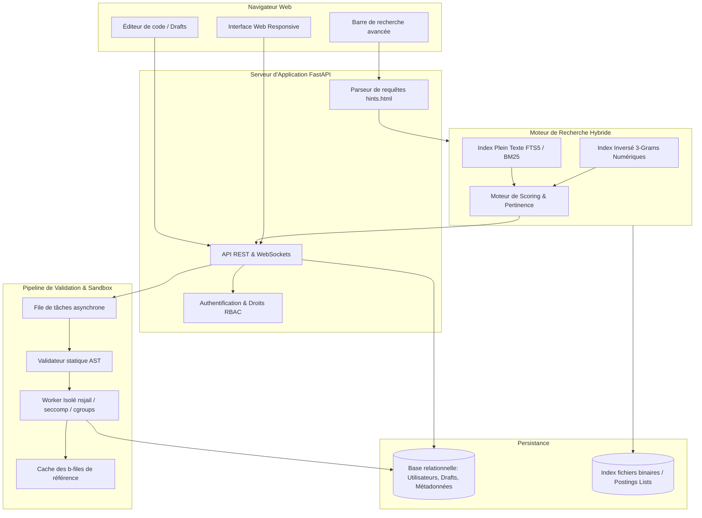

# Conception & Architecture : Clone Collaboratif OEIS en Python

Ce document détaille la conception technique pour faire évoluer le projet `oeis` en une plateforme collaborative moderne inspirée de **[OEIS.org](https://oeis.org/)**.

Elle permet aux utilisateurs enregistrés de soumettre, tester et versionner des implémentations de suites entières basées sur les trois piliers de la classe `Sequence` :
* `iterf` : générateur / itérateur produisant la séquence infinie.
* `itemf(n)` : calcul direct du $n$-ième terme.
* `containf(x)` : test d'appartenance booléen ($x \in S$).

Ce document décrit également l'architecture d'un **moteur de recherche hybride (numérique + texte)** conforme aux spécifications de **[oeis.org/hints.html](https://oeis.org/hints.html)** et aux travaux d'ingénierie de Russ Cox sur l'infrastructure de l'OEIS.

---

## 1. Vision et Objectifs

### 1.1 Contexte et limites de l'existant
* **`sequence.py`** : modèle abstrait performant combinant programmation fonctionnelle, générateurs et opérations ensemblistes/arithmétiques sur les suites (`+`, `*`, `&`, `|`, etc.).
* **`oeis.py`** : catalogue statique monolithique codé en dur en Python. L'ajout d'une suite nécessite une modification directe du code source sans interface web ni revue communautaire.
* **`database.py`** : stocke les termes compressés en SQLite via des triplets `(id, i, n, repeat)` et effectue des recherches de sous-séquences via des requêtes SQL dynamiques complexes (jointures CTE multiples). Cette méthode montre ses limites de passage à l'échelle dès que la séquence recherchée contient plus de 4 termes ou des entiers très fréquents (0, 1).
* **`test_oeis.py`** : compare les suites avec les fichiers de vérité terrain (`b-files` officiels).

### 1.2 Objectifs de la plateforme cible
1. **Dépôt exécutable standardisé** : centraliser pour chaque suite OEIS ($A000001 \dots A370000+$) une implémentation exécutable de `Sequence` documentée et testée.
2. **Workflow communautaire sécurisé (Crowdsourcing)** : permettre aux contributeurs de proposer des implémentations ou des optimisations via un système de soumission avec sandbox sécurisée et validation automatique.
3. **Moteur de recherche haute performance** : recherche instantanée supportant la syntaxe complète d'OEIS (termes consécutifs, non consécutifs, wildcards, sous-séquences, préfixes de champs, pertinence pondérée).
4. **Interface web interactive** : consultation des suites avec génération de graphiques dynamiques (Canvas/SVG), calcul à la volée, visualiseur de code et comparateur de versions (diff).

---

## 2. Architecture Globale du Système

Le système est découpé en services découplés garantissant réactivité et sécurité :



---

## 3. Moteur de Recherche Efficace (Spécifications hints.html)

### 3.1 Analyse des fonctionnalités de hints.html

Le moteur doit reproduire fidèlement les règles de recherche de l'OEIS :

| Type de recherche | Exemple | Comportement attendu |
| :--- | :--- | :--- |
| **Sous-séquence consécutive (virgules)** | `1,4,9,16,25` | Trouve les suites contenant exactement ces termes dans cet ordre, à n'importe quel offset. |
| **Sous-séquence consécutive (espaces)** | `1 4 9 16 25` | Si $\ge 3$ entiers séparés par des espaces, insertion automatique de virgules (consécutifs). |
| **Termes non consécutifs** | `"1" "4" "9"` ou `seq:1759 seq:1957` | Trouve les suites contenant tous ces nombres, indépendamment de leur position relative. |
| **Wildcard de terme unique** | `1, 2, _, 4, 5` | Le symbole `_` remplace exactement 1 entier arbitraire. |
| **Wildcard de sous-séquence** | `1, 2, __, 7, 8` ou `subseq:377,8` | Le symbole `__` remplace 0 ou plusieurs entiers (sous-séquence non nécessairement contiguë). |
| **Sensibilité au signe** | `signed:1,-1,0,-1,1` | Respecte le signe des termes (par défaut, `seq:` ignore les signes). |
| **Exclusion numérique** | `2 4 ~8 16` ou `-seq:5` | Trouve 2, 4, 16 mais exclut strictement les suites contenant le terme 8 ou 5. |
| **Préfixes de métadonnées** | `id:A000045`, `author:Guy`, `keyword:nice` | Recherche ciblée sur un champ particulier. |
| **Opérateur OU** | `keyword:nice\|keyword:core` | Disjonction logique (match si l'un ou l'autre est présent). |
| **Exclusion textuelle** | `keyword:nice -keyword:base` | Exclusion d'un mot-clé ou terme. |

### 3.2 Indexation numérique par N-Grams (3-Grams d'entiers)

Une recherche séquentielle en base relationnelle classique sur 370 000+ suites est inefficace en raison du volume ($> 3 \times 10^7$ termes) et de la distribution des entiers (les nombres comme 0, 1, 2 apparaissent dans une grande majorité des suites).

#### Solution : Index Inversé de 3-Grams
Chaque suite $S = (t_0, t_1, t_2, \dots, t_k)$ est découpée en fenêtres glissantes de 3 entiers consécutifs :
$$g_i = (t_i, t_{i+1}, t_{i+2})$$

L'index inversé associe à chaque triplet unique une liste de correspondances (postings list) :
```
Clé: Hash64(t_i, t_{i+1}, t_{i+2})
Valeur: [(seq_id_1, offset_a), (seq_id_2, offset_b), ...]
```

#### Pourquoi le 3-Gram est optimal ?
1. **Haute sélectivité** : même si 0, 1 et 2 sont ubiquitaires individuellement, le triplet `(5, 8, 13)` ou `(4, 9, 16)` ne correspond qu'à une poignée de suites dans tout le catalogue.
2. **Filtrage instantané** :
   * Une requête de 5 termes `[1, 4, 9, 16, 25]` est décomposée en trois 3-grams : `g1=(1,4,9)`, `g2=(4,9,16)`, `g3=(9,16,25)`.
   * On récupère la liste de `g1` et celle de `g3`. On calcule l'intersection des `seq_id` vérifiant :
     $$\text{offset}(g_3) = \text{offset}(g1) + 2$$
   * L'intersection réduit les candidats de 370 000 à moins de 5 suites en quelques microsecondes.
3. **Compression des postings** :
   * Les listes triées de `seq_id` et d'offsets sont compressées en mémoire à l'aide de **Roaring Bitmaps** ou de **Delta Encoding (VByte)**.

### 3.3 Indexation textuelle (SQLite FTS5 / Tantivy)
Pour les métadonnées (`id`, `name`, `comment`, `formula`, `author`, `keyword`, `xref`) :
* Utilisation d'un moteur Full-Text Search (FTS5 sous SQLite ou index Tantivy en Rust).
* Tokenisation avec racinisation (Porter Stemmer), identique au comportement décrit par Russ Cox dans l'OEIS historique.
* Gestion native des requêtes booléennes (`AND`, `OR`, `NOT`).

### 3.4 Algorithme de Scoring & Pertinence (+Score)
Le score de pertinence final d'un résultat est calculé par une combinaison linéaire :
$$\text{Score}(S) = W_{\text{num}} \cdot \text{Score}_{\text{seq}} + W_{\text{text}} \cdot \text{Score}_{\text{BM25}} + W_{\text{pop}} \cdot \log(1 + \text{Inlinks}(S))$$

* **$\text{Score}_{\text{seq}}$ (Score numérique)** :
  * Match exact consécutif complet : +100 points.
  * Correspondance au début de la suite ($\text{offset} \le 2$) : +20 points.
  * Sous-séquence non consécutive (via `__` ou `subseq:`) : score proportionnel au taux de couverture et à la compacité.
* **$\text{Score}_{\text{BM25}}$ (Score textuel)** : pertinence des termes trouvés dans le nom ou les commentaires.
* **$\text{Inlinks}(S)$ (Popularité)** : nombre de fois où la suite $S$ est citée dans les champs `xref` des autres suites (équivalent PageRank).

---

## 4. Soumission et Sandboxing de Code Python (`iterf`, `itemf`, `containf`)

### 4.1 Spécifications des trois fonctions de `Sequence`
Pour toute suite $Axxxxxx$, un utilisateur peut soumettre du code pour :
* **`iterf`** : `def iterf(): ...` (générateur avec `yield`).
* **`itemf`** : `def itemf(n): return ...` (fonction calculant $a(n)$).
* **`containf`** : `def containf(x): return ...` (prédicat booléen déterminant si $x \in S$).

### 4.2 Problématiques de Sécurité & Modèle de Menace
L'exécution de code Python arbitraire soumis par des utilisateurs expose le serveur à :
1. **Exécution de commandes système (RCE)** : `import os; os.system("...")`.
2. **Évasion via l'introspection Python** : `().__class__.__base__.__subclasses__()[...]`.
3. **Déni de service CPU** : boucles infinies ou algorithmes de complexité prohibitive.
4. **Saturation de la mémoire (OOM)** : allocation massive de tableaux ou entiers démesurés.
5. **Fuite d'informations / Accès réseau** : requêtes sockets, ouverture de fichiers locaux.

### 4.3 Architecture de Sandboxing à Double Barrière

```
  Code Soumis
      │
      ▼
┌───────────────────────────────────────────────┐
│ Barrière 1 : Analyse Statique AST             │
│ - Parcours de l'arbre syntaxique (ast.NodeVisitor)
│ - Rejet si 'import os/sys/subprocess/socket'   │
│ - Rejet des attributs 'eval', 'exec', '__*'   │
│ - Modules autorisés : math, itertools, goulib │
└──────────────────────┬────────────────────────┘
                       │ Validé
                       ▼
┌───────────────────────────────────────────────┐
│ Barrière 2 : Isolation Runtime de l'Exécution │
│ - Processus fils dédié (Fork isolé / nsjail)   │
│ - Limites cgroups & setrlimit :               │
│     * RLIMIT_CPU = 2.0 s                      │
│     * RLIMIT_AS = 256 Mo (Mémoire virtuelle)  │
│     * RLIMIT_NOFILE = 0 (Aucun descripteur)   │
│ - Pas d'accès réseau (Network namespace vide)  │
└──────────────────────┬────────────────────────┘
                       │
                       ▼
              Résultat d'Exécution
```

#### Implémentation du Validateur AST (Extrait de conception)
```python
import ast

DISALLOWED_NODES = (
    ast.Import, ast.ImportFrom,  # seuls les imports gérés par l'hôte sont injectés
    ast.Global, ast.Nonlocal,
)

DISALLOWED_NAMES = {
    'eval', 'exec', 'open', '__import__', 'compile', 'getattr', 'setattr',
    'delattr', 'globals', 'locals', 'vars'
}

class SecurityASTValidator(ast.NodeVisitor):
    def visit_Name(self, node):
        if node.id in DISALLOWED_NAMES or node.id.startswith('__'):
            raise ValueError(f"Identifiant non autorisé: {node.id}")
        self.generic_visit(node)

    def visit_Attribute(self, node):
        if node.attr.startswith('__'):
            raise ValueError(f"Accès dunder interdit: {node.attr}")
        self.generic_visit(node)
```

### 4.4 Protocole de Validation Automatique (Test Runner)
Une fois le code validé par l'AST, le sandbox exécute une batterie de tests :

1. **Test de concordance avec la référence ($b\text{-file}$)** :
   * Génération des $N$ premiers termes via `iterf()` (ex: $N=100$).
   * Comparaison terme à terme : `generated[i] == bfile[i]`.
   * Si divergence à l'indice $k$ : échec immédiat avec retour précis (`Erreur à n=k : attendu X, obtenu Y`).
2. **Test de cohérence `itemf(n)`** :
   * Pour $n \in [0, \min(N, 50)]$, vérification que `itemf(n) == bfile[n]`.
3. **Test de cohérence `containf(x)`** :
   * Test de positivité : vérification que $\forall x \in \{bfile[0], \dots, bfile[30]\}$, `containf(x) == True`.
   * Test de négativité : injection d'entiers connus comme n'appartenant pas à la suite, vérification de `containf(x) == False`.
4. **Benchmarking automatique** :
   * Mesure du temps d'exécution par terme généré ($\mu s/\text{terme}$).
   * Attribution d'un tag de performance (`fast`, `medium`, `slow`).

---

## 5. Modèle de Données Relationnel

Schéma SQL pour la persistance des suites, utilisateurs et soumissions :

```sql
-- Utilisateurs et Rôles
CREATE TABLE users (
    id INTEGER PRIMARY KEY AUTOINCREMENT,
    username VARCHAR(50) UNIQUE NOT NULL,
    email VARCHAR(120) UNIQUE NOT NULL,
    password_hash VARCHAR(255) NOT NULL,
    role VARCHAR(20) DEFAULT 'contributor', -- 'contributor', 'reviewer', 'admin'
    created_at TIMESTAMP DEFAULT CURRENT_TIMESTAMP
);

-- Catalogue des Séquences
CREATE TABLE sequences (
    id VARCHAR(7) PRIMARY KEY, -- 'A000045'
    name TEXT NOT NULL,
    offset_val INTEGER DEFAULT 0,
    terms_preview TEXT NOT NULL, -- Premiers termes affichés en résumé
    keywords TEXT, -- 'core,nice,easy'
    author TEXT,
    inlink_count INTEGER DEFAULT 0, -- Nombre de références croisées (popularité)
    current_implementation_id INTEGER, -- Pointeur vers l'implémentation active
    FOREIGN KEY(current_implementation_id) REFERENCES implementations(id)
);

-- Implémentations et Soumissions de Code (Drafts / Versions)
CREATE TABLE implementations (
    id INTEGER PRIMARY KEY AUTOINCREMENT,
    sequence_id VARCHAR(7) NOT NULL,
    user_id INTEGER NOT NULL,
    status VARCHAR(20) DEFAULT 'draft', -- 'draft', 'submitted', 'approved', 'rejected', 'superseded'
    iterf_code TEXT,
    itemf_code TEXT,
    containf_code TEXT,
    description TEXT,
    test_status VARCHAR(20), -- 'passed', 'failed', 'timeout', 'error'
    test_logs TEXT,
    terms_verified_count INTEGER DEFAULT 0,
    benchmark_us_per_term FLOAT,
    submitted_at TIMESTAMP DEFAULT CURRENT_TIMESTAMP,
    reviewed_by INTEGER,
    reviewed_at TIMESTAMP,
    review_comment TEXT,
    FOREIGN KEY(sequence_id) REFERENCES sequences(id),
    FOREIGN KEY(user_id) REFERENCES users(id),
    FOREIGN KEY(reviewed_by) REFERENCES users(id)
);

-- Table pour l'index inversé de 3-Grams (numérique)
CREATE TABLE ngram_index (
    ngram_hash INTEGER NOT NULL, -- Hash 64-bit du triplet (t0, t1, t2)
    sequence_id VARCHAR(7) NOT NULL,
    offset_pos INTEGER NOT NULL,
    PRIMARY KEY (ngram_hash, sequence_id, offset_pos)
);
CREATE INDEX idx_ngram_hash ON ngram_index(ngram_hash);

-- Table Virtuelle FTS5 pour la recherche plein texte
CREATE VIRTUAL TABLE sequences_fts USING fts5(
    id UNINDEXED,
    name,
    comments,
    author,
    keywords,
    tokenize='porter'
);
```

---

## 6. Conception de l'Interface Utilisateur (UI/UX)

L'interface web combine l'efficacité typographique historique de l'OEIS avec l'ergonomie des outils de développement modernes :

1. **Barre de Recherche Omnibox** :
   * Auto-complétion sur les numéros de suite (`A00004...`).
   * Détection intelligente : reconnaissance automatique d'une liste de nombres pour passer en mode recherche de sous-séquence.
   * Aide contextuelle avec raccourcis de syntaxe (`id:`, `author:`, `_`, `~`).
2. **Fiche Séquence** :
   * **En-tête** : identifiant OEIS, nom complet, mots-clés, auteur.
   * **Données numériques** : termes affichés avec mise en valeur des termes correspondants à la recherche, bouton d'export $b\text{-file}$.
   * **Graphes dynamiques** : rendu interactif Canvas/SVG des premiers termes (mode dispersion, logarithmique, différences finies).
   * **Implémentation Python** : affichage du code de `Sequence(iterf, itemf, containf)` avec coloration syntaxique.
   * **Console de test interactive** : zone permettant à tout visiteur de tester la suite en direct dans le navigateur (ex: "Calculer les termes jusqu'à $n=500$" ou "Tester si $10946 \in S$").
3. **Espace Contributeur (Draft & Review Dashboard)** :
   * Éditeur de code intégré (Monaco Editor) avec vérification de syntaxe en temps réel.
   * Bouton **"Tester mon code"** déclenchant la validation sandbox et affichant le rapport de conformité en quelques secondes.
   * Comparateur visuel côte à côte (Diff viewer) entre la version actuellement approuvée et la proposition de modification.

---

## 7. Feuille de Route d'Implémentation (Roadmap)

### Phase 1 : Cœur Moteur de Recherche & Indexation
* [ ] Développer `QueryParser` pour parser la syntaxe `hints.html` (détection des nombres, préfixes, wildcards, disjonctions).
* [ ] Développer le générateur d'index inversé 3-grams pour les termes numériques.
* [ ] Initialiser la table SQLite FTS5 pour les métadonnées textuelles.
* [ ] Implémenter l'algorithme de scoring et de fusion des résultats numériques et textuels.
* [ ] Tester les performances du moteur sur un export représentatif de l'OEIS (`stripped.gz`).

### Phase 2 : Sandbox et Moteur de Test des Fonctions
* [ ] Implémenter le validateur statique AST pour bloquer les imports et fonctions interdites.
* [ ] Créer l'exécuteur en sous-processus isolé avec limites strictes de ressources (`setrlimit`, CPU, mémoire, I/O).
* [ ] Implémenter le banc de validation croisée (`iterf` vs `itemf` vs `containf` vs $b\text{-file}$).
* [ ] Intégrer la mesure de performance (benchmarks en temps et mémoire).

### Phase 3 : Backend API & Gestion des Utilisateurs
* [ ] Mettre en place l'application **FastAPI** avec architecture modulaire (routes `search`, `sequences`, `drafts`, `auth`).
* [ ] Implémenter l'authentification (JWT / cookies sécurisés) et le contrôle d'accès basé sur les rôles (contributeur, relecteur, administrateur).
* [ ] Écrire les endpoints de soumission de draft, d'exécution de tests à la volée et de validation éditoriale.

### Phase 4 : Interface Web & Visualisation
* [ ] Développer l'interface utilisateur web responsive et moderne.
* [ ] Intégrer l'éditeur de code (Monaco Editor ou CodeMirror) pour les soumissions.
* [ ] Développer le module de tracé de graphiques interactifs pour les termes de suites.
* [ ] Mettre en place la page de revue des propositions avec visualiseur de diff.
